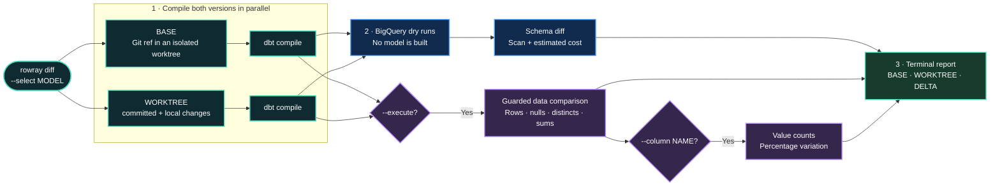

<h1 align="center">
  <a href="https://github.com/mathieuMTT/rowray"></a>
</h1>

<p align="center"><strong>See what changed. Know what it costs. Ship dbt with confidence.</strong></p>

<p align="center">
  <a href="https://pypi.org/project/rowray/"></a>
  <a href="https://pypi.org/project/rowray/">=3.10" src="https://img.shields.io/badge/dynamic/json?url=https%3A%2F%2Fpypi.org%2Fpypi%2Frowray%2Fjson&amp;query=%24.info.requires_python&amp;label=python&amp;style=flat-square&amp;logo=python&amp;logoColor=white"></a>
  <a href="LICENSE"></a>
  <a href="https://github.com/mathieuMTT/rowray/stargazers"></a>
</p>

RowRay gives your dbt models X-ray vision.

Compare Git BASE against your current working tree for schema drift, data shifts, and BigQuery scan cost—without materializing a model.

**Built for analytics engineers using dbt + BigQuery.**

- 🔬 Catch schema and data changes before production
- 💸 Compare incremental and full-refresh scan costs
- ⚡ Test committed, staged, unstaged, and untracked work

## How RowRay works



**Safe by default:** RowRay compiles SQL and uses BigQuery dry runs. It never builds or materializes the model.

**Optional data comparison:** `--execute` runs one guarded aggregate query, dry-runs it first, and caps it at 200 GiB. `--column NAME` adds a separate guarded value-count comparison.

**Full-refresh estimates:** `--full-refresh` adds parallel full-refresh compiles and dry runs for BASE and WORKTREE. It never executes the full-refresh SQL.

## What it compares

By default, RowRay compiles both versions and uses BigQuery dry runs to report:

- Bytes scanned and estimated on-demand cost
- Top-level columns added or removed
- Top-level column type changes

With `--execute`, RowRay runs guarded aggregate queries and also reports:

- Row counts
- Null rates
- Approximate distinct counts
- Sums for numeric columns

With `--column NAME`, it adds BASE and working-tree row counts plus percentage variation for every value in one column.

## How it runs

| Stage | What happens in BigQuery | Potentially billed |
| --- | --- | --- |
| `dbt compile` | dbt may run metadata lookups or project macros | Project-dependent |
| `Dry-run BASE/WORKTREE` | Validates incremental SQL and estimates schema, scan, and cost | No |
| `Dry-run full-refresh BASE/WORKTREE` | Estimates full-refresh SQL when `--full-refresh` is passed | No |
| `Dry-run incremental data comparison` | Validates the combined comparison query and enforces the 200 GiB limit | No |
| `Run incremental data comparison` | Reads BASE and WORKTREE to calculate rows and column metrics | Yes |
| `Dry-run column NAME` | Validates the value-count query and enforces its own 200 GiB limit | No |
| `Analyze column NAME` | Counts rows for every value of the selected column | Yes |

RowRay never runs a dbt materialization, `MERGE`, or full-refresh build. Only `--execute` and `--column` cause RowRay itself to execute data-reading queries.

## Requirements

- Python 3.10+
- Git
- An existing dbt project connected to BigQuery
- A `dbt` executable available in the current shell

Before installing RowRay, this must succeed from the dbt project:

```bash
dbt debug
```

RowRay reuses the project's `dbt_project.yml`, `profiles.yml`, target, environment variables, and BigQuery credentials. OAuth/ADC, `service-account`, and `service-account-json` profiles are supported.

## Install

Install RowRay from PyPI with [uv](https://docs.astral.sh/uv/):

```bash
uv tool install rowray
rowray --help
```

If uv says its executable directory is missing from `PATH`, run `uv tool update-shell` and restart the shell.

Run once without permanent installation:

```bash
uvx rowray --help
```

## Use

Run RowRay inside the existing dbt project:

```bash
rowray diff --select my_model
```

The Git base defaults to `origin/HEAD`, then `origin/main`, then `origin/master`. Override it or the dbt target when needed:

```bash
rowray diff --select my_model --base origin/main --target dev
```

Compile against a production target while submitting RowRay's BigQuery jobs from a project where you have `bigquery.jobs.create`:

```bash
rowray diff --select my_model --target prod --execution-project my-dev-project
```

`--execution-project` overrides `execution_project` from the selected profile output, which otherwise falls back to its `project`. It affects RowRay dry runs and aggregate queries; dbt compilation still uses `--target`.

The effective project is selected in this order:

```text
--execution-project
→ execution_project from the selected profiles.yml output
→ project from the selected profiles.yml output
```

A common read-only production setup grants `roles/bigquery.dataViewer` on the referenced production datasets and `roles/bigquery.jobUser` on the execution project. BigQuery dry runs are free, but still require `bigquery.jobs.create` in that execution project.

Pass required dbt variables as YAML or JSON. Identical values are used for BASE and the working tree:

```bash
rowray diff \
  --select my_model \
  --vars '{"execution_date":"2026-10-29"}'
```

Forward dbt warning handling when the project promotes warnings to errors:

```bash
rowray diff \
  --select my_model \
  --warn-error-options '{"silence":["CustomKeyInConfigDeprecation"]}'
```

Add full-refresh scan estimates for BASE and the working tree. This runs two extra compiles and dry runs, but still does not materialize the model:

```bash
rowray diff --select my_model --full-refresh
```

By default, full-refresh compiles reuse `--vars`. Override only the values that differ by merging the top-level keys from `--full-refresh-vars` over them:

```bash
rowray diff \
  --select my_model \
  --vars '{"execution_date":"2026-09-29","inception_date":"2026-09-23"}' \
  --full-refresh \
  --full-refresh-vars '{"inception_date":"2019-10-23"}'
```

With `--full-refresh`, RowRay runs four compiles concurrently and displays their progress independently:

```text
⠋ Compile incremental BASE (origin/main)
⠙ Compile incremental WORKTREE
⠹ Compile full-refresh BASE (origin/main)
⠸ Compile full-refresh WORKTREE
```

If BASE declares `packages.yml` or `dependencies.yml`, RowRay first runs `dbt deps` in its temporary worktree because local `dbt_packages/` directories are normally ignored by Git.

## Compare incremental data

Comparing rows and column metrics requires explicit execution:

```bash
rowray diff --select my_model --execute
```

Analyze counts and variation for every value of one shared scalar column:

```bash
rowray diff --select my_model --execute --column event_type
```

`--column` prints actual distinct values. Do not use it on sensitive or very high-cardinality columns unless that terminal output is acceptable.

## Complete example

```bash
rowray diff \
  --select mart_traffic__fact_event \
  --target prod \
  --execution-project data-dev \
  --vars '{"execution_date":"2026-10-29","inception_date":"2026-10-23"}' \
  --full-refresh \
  --full-refresh-vars '{"inception_date":"2019-01-01"}' \
  --warn-error-options '{"silence":["CustomKeyInConfigDeprecation"]}' \
  --execute \
  --column event_type
```

This estimates incremental and full-refresh scan costs for BASE and WORKTREE. It executes only the incremental row/column comparison and the requested `event_type` value counts.

## Execution and cost safety

- BASE compiles in an isolated Git worktree.
- BASE and the current dbt project compile concurrently with isolated target directories; the current project includes committed, staged, unstaged, and untracked changes.
- BigQuery comparisons are dry-run only unless `--execute` is passed.
- `--execution-project` changes where RowRay submits BigQuery jobs, not which datasets the compiled SQL reads.
- `--full-refresh` runs incremental and full-refresh compiles together; full-refresh SQL is dry-run only.
- `--execute` and `--column` compare only the incremental SQL, never the full-refresh SQL.
- Each aggregate query is dry-run first and skipped above 200 GiB.
- Each executed aggregate query also sets `maximum_bytes_billed` to 200 GiB.
- `--column` runs an additional aggregate query with its own 200 GiB cap.
- Raw rows are not downloaded, but `--column` downloads distinct values and their counts.
- dbt compilation may run warehouse introspection or project macros such as `run_query`; RowRay cannot make arbitrary dbt projects query-free.

The scan/cost table estimates the compiled model SQL for each side. It does not include any warehouse activity triggered by project-specific dbt macros or the potentially billed queries run by `--execute` and `--column`.

The displayed USD amount is an estimate:

```text
bytes processed / 1024⁴ × $6.25
```

`$6.25/TiB` is a fixed [BigQuery on-demand list price](https://cloud.google.com/bigquery/pricing), not fetched automatically. The estimate does not account for the free tier, capacity pricing, reservations, discounts, currency, or prior monthly usage.

## Current limits

- One selected model per command
- BigQuery only
- Top-level schema comparison only
- Schema comparison checks column names and types, not `NULLABLE`/`REQUIRED` mode changes
- Data comparison skips repeated, nested, `GEOGRAPHY`, and `JSON` columns
- Distinct counts use `APPROX_COUNT_DISTINCT`
- `--column` returns every value without an output limit
- `--full-refresh-vars` performs a shallow merge; overriding a nested mapping replaces that complete top-level value
- The current project must already have its dbt dependencies installed; RowRay installs dependencies only in the BASE worktree

## Update or remove

```bash
uv tool upgrade rowray
uv tool uninstall rowray
```

## License

Copyright 2026 Mathieu Rozé.

Licensed under the [Apache License 2.0](LICENSE).
